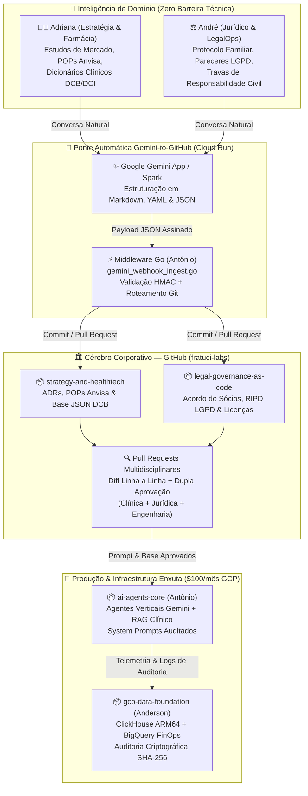

# 🧬 Fratuci Labs — Venture Studio & AI-First Family Enterprise
### *Building High-Trust Vertical AI, Real-Time Data Platforms & Legal-as-Code Governance*

> [!IMPORTANT]
> **Bem-vindo ao Cérebro Corporativo da Fratuci Labs (`fratuci-labs`)**  
> Somos uma empresa familiar 100% remota, multidisciplinar e orientada a Inteligência Artificial. Operamos sob o paradigma **GitHub-First ("Everything as Code")**: toda infraestrutura de nuvem, agentes autônomos, diretrizes clínicas/farmacológicas, contratos societários e decisões estratégicas de negócio vivem em repositórios versionados, auditáveis e rastreáveis.

---

## 🎯 Nossa Missão | *Our Mission*

Unir **Engenharia de Dados de Alta Performance**, **Agentes Autônomos de IA**, **Segurança Jurídica (*Legal as Code*)** e **Rigor Científico/Empresarial (*HealthTech & Strategy*)** para construir produtos digitais B2B resilientes, econômicos e auditáveis desde o primeiro commit.

Na **Fratuci Labs**, eliminamos a barreira entre áreas técnicas e de negócios: conversas estratégicas, pareceres regulatórios da Anvisa e minutas jurídicas elaboradas com apoio do **Google Gemini** são convertidas automaticamente em *Commits* e *Pull Requests*, onde toda a família revisa, aprova e audita cada decisão linha a linha.

---

## 👥 Os 4 Pilares Societários | *Board of Directors & Co-Founders*

| Diretor(a) / Sócio(a) | Cargo & Domínio | Foco Estratégico na Operação | Repositório Principal |
| :--- | :--- | :--- | :--- |
| **Anderson** (`@fratuci`) | **Arquiteto de Dados & Cloud** *(Data & Cloud Architecture)* | Infraestrutura Google Cloud (GCP), FinOps rigoroso (**cota de US$ 100/mês**), motores analíticos (**ClickHouse ARM64 / BigQuery**), pipelines em **Go/Rust** e segurança Zero-Trust (**Workload Identity Federation**). | [`gcp-data-foundation`](https://github.com/fratuci-labs/gcp-data-foundation) |
| **Antônio** | **Engenharia de IA & Agentes Autônomos** *(AI Engineering & Autonomous Agents)* | Agentes Verticais (**Vertex AI / Gemini**), arquiteturas RAG sobre bases em Markdown/JSON, **System Prompts como Código** e o middleware em Go que converte resumos do Gemini da Adriana e do André em commits/PRs no GitHub. | [`ai-agents-core`](https://github.com/fratuci-labs/ai-agents-core) |
| **André** | **Diretoria Jurídica, Governança & LegalOps** *(Legal Counsel, Governance & LegalOps — Direito)* | **Legal as Code**, Protocolo Familiar e Acordo de Sócios (separação estrita entre **Pró-Labore** e **Lucros**), conformidade **LGPD & Marco Legal da IA**, curadoria jurídica de System Prompts e auditoria de licenças open-source (`MIT`/`Apache-2.0` vs. `AGPL`). | [`legal-governance-as-code`](https://github.com/fratuci-labs/legal-governance-as-code) |
| **Adriana** | **Estratégia de Negócios, Produto & Farmácia** *(Business Strategy, Product & Clinical Pharma)* | Gestão ágil de negócios (Roadmaps, ADRs estratégicos), avaliação das **3 Verticais de Mercado**, conformidade sanitária (**Anvisa / POPs versionados**) e curadoria de dicionários clínicos/farmacológicos (**DCB/DCI**, interações críticas em JSON). | [`strategy-and-healthtech`](https://github.com/fratuci-labs/strategy-and-healthtech) |

---

## 🔄 Fluxo Operacional "Zero Barreira Técnica" | *Gemini-to-GitHub Operating Model*

O diagrama abaixo ilustra como a **Adriana** (Negócios & Farmácia) e o **André** (Jurídico & Governança) produzem conhecimento especializado conversando naturalmente com o **Gemini App / Gemini Spark**, e como esse conhecimento alimenta a engenharia de IA do **Antônio** e a fundação de dados do **Anderson**:

---

## 🚀 As 3 Verticais de Negócio em Prospecção | *Target Market Verticals*

A **Fratuci Labs** estrutura sua tese de investimentos e desenvolvimento de produto em três frentes de alta margem B2B (detalhadas na [`ADR-001`](https://github.com/fratuci-labs/strategy-and-healthtech/blob/main/business-adrs/ADR-001-selecao-verticais-mercado.md)):

### 1. 🏥 IA Vertical para Saúde & Farmácia (*HealthTech & Clinical Decision Support*)
- **Problema:** Erros de conciliação medicamentosa, interações graves não detectadas no balcão/clínica e alto custo de conformidade sanitária (RDC Anvisa).
- **Solução Fratuci Labs:** Copiloto farmacêutico e de triagem clínica que cruza prescrições com bases determinísticas curadas em **DCB/DCI** (`interacoes-medicamentosas-criticas.json`), com **trava absoluta contra prescrição autônoma**, exigência de validação humana em alertas de alta severidade e trilha de auditoria imutável.

### 2. ⚡ Engenharia de Dados em Tempo Real & AI Readiness (*Data/Stream Ops*)
- **Problema:** Empresas médias sufocadas por custos de nuvem descontrolados e pipelines lentos que impedem a adoção segura de IA generativa.
- **Solução Fratuci Labs:** Arquiteturas *lean* baseadas em **ClickHouse em ARM64**, ingestão em **Go/Rust**, governança FinOps estrita e camadas semânticas prontas para RAG corporativo com latência sub-segundo.

### 3. 🚚 Inteligência Preditiva para Logística, Suprimentos e Risco (*LogTech & Risk Intelligence*)
- **Problema:** Rupturas de estoque farmacêutico/hospitalar, perdas na cadeia fria (*cold chain*) e desvios operacionais em frotas e centros de distribuição.
- **Solução Fratuci Labs:** Telemetria contínua de eventos em tempo real combinada com agentes de detecção de anomalias e conformidade contratual automatizada.

---

## 🗂️ Mapa de Repositórios Operacionais | *Core Repositories*

| Repositório | Líder | Descrição Executiva | Links Rápidos |
| :--- | :--- | :--- | :--- |
| **[`fratuci-labs/gcp-data-foundation`](https://github.com/fratuci-labs/gcp-data-foundation)** | **Anderson** | Arquitetura de Dados em Tempo Real, FinOps GCP (**US$ 100 Quota**) e Infraestrutura Serverless/ClickHouse ARM. | [Terraform](https://github.com/fratuci-labs/gcp-data-foundation/blob/main/infra/main.tf) · [ClickHouse DDL](https://github.com/fratuci-labs/gcp-data-foundation/blob/main/schemas/clickhouse_healthtech_events.sql) · [Política FinOps](https://github.com/fratuci-labs/gcp-data-foundation/blob/main/docs/finops-policy.md) |
| **[`fratuci-labs/ai-agents-core`](https://github.com/fratuci-labs/ai-agents-core)** | **Antônio** | Motor de Agentes Autônomos, System Prompts Auditáveis e Ponte Automática Gemini-to-GitHub em Go. | [System Prompt Saúde](https://github.com/fratuci-labs/ai-agents-core/blob/main/prompts/pharma-triage-system-prompt.md) · [Webhook Go](https://github.com/fratuci-labs/ai-agents-core/blob/main/automation/gemini_webhook_ingest.go) |
| **[`fratuci-labs/legal-governance-as-code`](https://github.com/fratuci-labs/legal-governance-as-code)** | **André** | *Legal as Code*: Protocolo Familiar, Acordo de Sócios, Compliance LGPD/IA e Auditoria de Licenças Open-Source. | [Protocolo Familiar](https://github.com/fratuci-labs/legal-governance-as-code/blob/main/societario/protocolo-familiar-e-acordo-de-socios.md) · [Matriz LGPD/IA](https://github.com/fratuci-labs/legal-governance-as-code/blob/main/compliance-ia/matriz-risco-lgpd-e-ia.md) · [Licenças OSS](https://github.com/fratuci-labs/legal-governance-as-code/blob/main/legalops/politica-licencas-open-source.md) |
| **[`fratuci-labs/strategy-and-healthtech`](https://github.com/fratuci-labs/strategy-and-healthtech)** | **Adriana** | Estratégia de Mercado, ADRs de Produto, Governança Sanitária (Anvisa) e Bases Clínicas/Farmacêuticas DCB/DCI. | [ADR-001 Verticais](https://github.com/fratuci-labs/strategy-and-healthtech/blob/main/business-adrs/ADR-001-selecao-verticais-mercado.md) · [POP-001 Anvisa](https://github.com/fratuci-labs/strategy-and-healthtech/blob/main/regulatorio-anvisa/POP-001-validacao-sistemas-computadorizados.md) · [Base DCB JSON](https://github.com/fratuci-labs/strategy-and-healthtech/blob/main/pharma-data/interacoes-medicamentosas-criticas.json) |

---

> [!TIP]
> **Princípio de Governança Familiar:**  
> *"Na Fratuci Labs, nenhum modelo de IA entra em produção sem o selo clínico da Adriana, o visto jurídico do André, a engenharia de agentes do Antônio e a trilha de auditoria FinOps do Anderson."*
